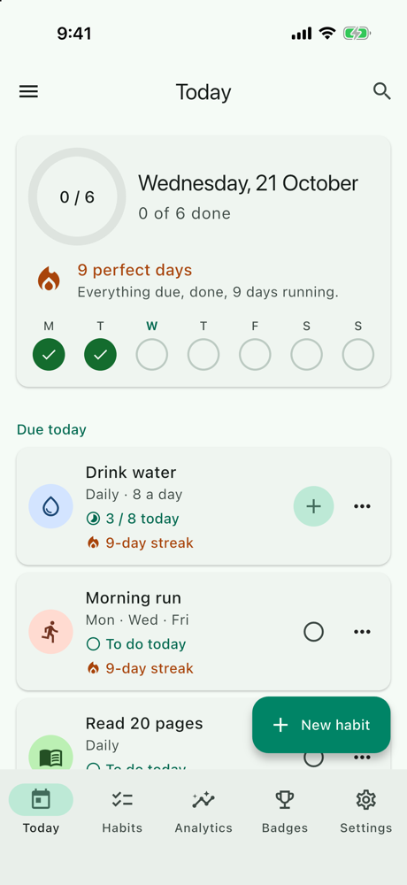
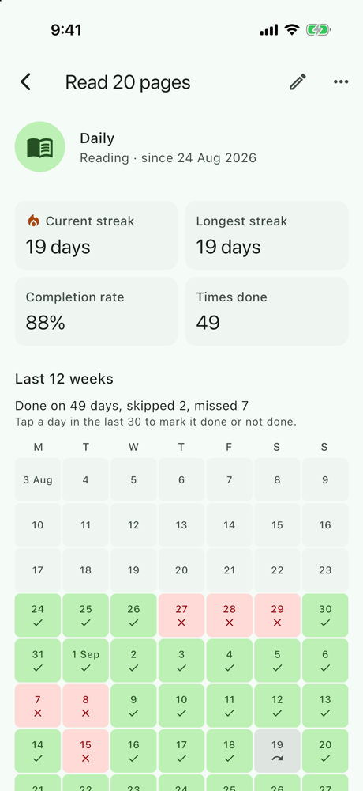
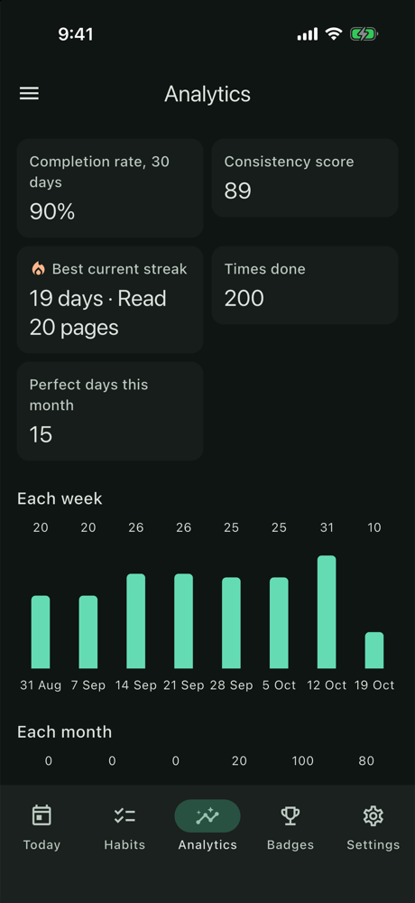
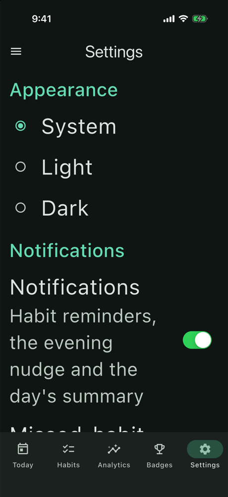
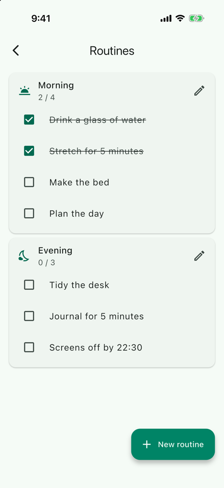
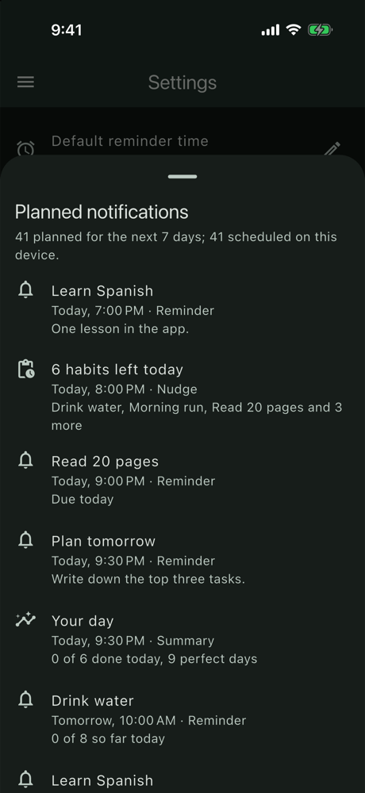
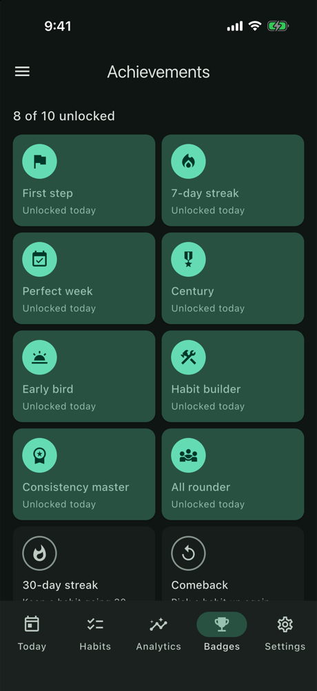
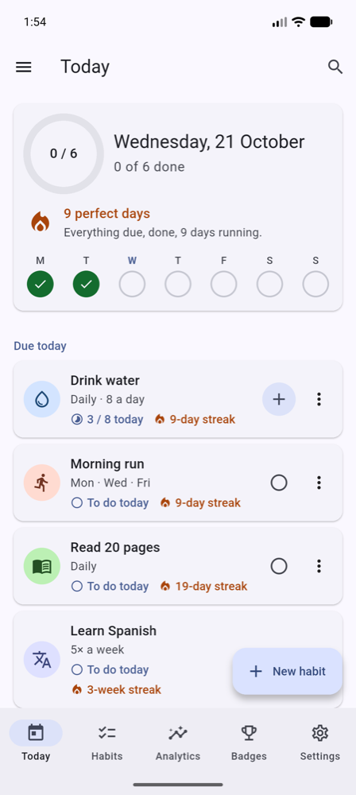

# 🌱 Momentum (Flutter)

[](https://github.com/MuhammadFaheemAkram/Momentum-Flutter/actions/workflows/flutter-ci.yml)


A learning-focused, production-inspired **Flutter** habit and productivity app:
- build **habits** that follow a schedule (every day, chosen weekdays, or N times a week), with daily targets and skips;
- keep **streaks** and a perfect-day streak;
- run **routines**, set **goals** and earn **achievements**;
- read your **analytics** and **search** everything;
- get **reminders** you can mark done straight from the notification.

It is built with **Flutter 3.47**, **Dart 3.13** and a clean, layered architecture, and runs on **Android and iOS**.

Momentum is **local-first**: everything lives in a database on the device, and a fake service in the app delivers the demo and receives simulated backups. There is **no API key and no server**.

> **Why this repo exists**
>
> It is the Flutter edition of an app that also exists natively for [Android](https://github.com/MuhammadFaheemAkram/Momentum) and [iOS](https://github.com/MuhammadFaheemAkram/iMomentum). This edition follows the **Android** one closely (its Jetpack Compose UI is already Material 3) and adapts to iOS where the platform has its own conventions. It focuses on:
> - a **schedule-aware habit engine:** "due today", streaks, perfect days and the consistency score follow each habit's schedule, and a day that wasn't due, or was skipped, never breaks a streak;
> - **derived, never stored:** streaks, rates, goal progress and scores are calculated from dated logs;
> - **achievements as pure rules**, each unlock recorded once with its date;
> - **notifications that are planned:** a pure planner turns habits and logs into the next week of reminders, and a scheduler applies only the difference;
> - **background work in a second isolate** (`workmanager`), sharing the database and the business rules with the app;
> - typed `go_router` navigation with a tab bar *and* a navigation drawer, code-generated DI, and a test suite that includes an accessibility tour.
>
> Each phase ships with a beginner-to-intermediate friendly write-up in [`docs/`](docs/) that also shows how the Android and iOS editions approached the same feature.

---

## 📋 Project Status

Momentum was built in **strict, reviewable phases**, and all seven are complete. Each phase ended with:
- a building app (Android + iOS);
- a clean analyzer and passing tests;
- a summary doc;
- exactly one commit.

| Phase | Scope | Status |
|------:|-------|:------:|
| 1 | Foundation: FVM project, design system base with the habit palette, typed routes with a first-launch gate, 5-tab shell with a navigation drawer, CI | ✅ Done |
| 2 | Data models, the drift store with its constraints, the fake service and the demo; Welcome for real | ✅ Done |
| 3 | The schedule engine (due days, streaks, perfect days, rates), Today, Habits, the habit form and Habit detail with a calendar you can backfill | ✅ Done |
| 4 | Goals counted per day, ISO week or month; routines with steps reordered by drag or screen reader, checked off each day; both on Today | ✅ Done |
| 5 | Ten badges as rules over the history, unlocked once and celebrated; analytics with the consistency score; debounced search with recent searches | ✅ Done |
| 6 | Reminders planned a week ahead and kept in step, with "Mark done"; background tasks in a second isolate; Settings (appearance, dynamic color, notifications, backup, reset, developer tools) | ✅ Done |
| 7 | The docs (architecture, data model, the habit engine worked through, notifications, background work, testing), screenshots, community files, and mutation checks of the key behaviours | ✅ Done |

---

## ✨ Features

- 🚀 **First launch:** explore with a demo (habits, 8 weeks of history, routines, goals) or start empty
- ☀️ **Today:** a ring for today's due habits, the perfect-day streak, complete, +1, skip and undo, today's routines and goals, the reminders coming up, this week at a glance
- ✅ **Habits:** daily, on chosen weekdays or N times a week; a daily target ("8 glasses"); start date, reminder time, color and icon; search, categories, archive
- 🗓️ **Habit detail:** a calendar heatmap you can backfill, current and longest streak, completion rate, a weekly chart
- 🌅 **Routines:** ordered items, drag to reorder (with screen-reader move actions), checked off for today
- 🎯 **Goals:** daily, weekly and monthly, counted from your logs
- 🏆 **Achievements:** badges with the date you earned them and progress toward the next
- 📈 **Analytics:** completion rate, consistency score, weekly and monthly bars, streak history, your most successful habit, categories
- 🔎 **Search:** habits, routines, goals and achievements
- 🔔 **Reminders:** only on due days and not once done, a "Mark done" action, a missed-habit nudge and a daily summary
- ⚙️ **Settings:** appearance, dynamic color (Android 12+), notifications with the nudge and summary times, a default reminder time, backups (now, or daily in the background), reset progress, developer tools (simulate failure, run the background tasks, show the plan)
- ♿ **Accessible:** dark mode and large text on every screen, labelled controls, never color alone, checked by a test tour that grows with the app

---

## 📸 Screenshots

| Today | A habit's page | Analytics (dark) | Settings at large text |
|:---:|:---:|:---:|:---:|
|  |  |  |  |

| Routines | Planned notifications | Badges | Android, dynamic color |
|:---:|:---:|:---:|:---:|
|  |  |  |  |

All 20, with what to look for and how to retake them: [docs/SCREENSHOTS.md](docs/SCREENSHOTS.md).

---

## 🧰 Tech Stack

Packages arrive in the phase that first needs them.

| Area | Choice | Since |
|------|--------|:-----:|
| Toolchain | Flutter 3.47.6 · Dart 3.13, pinned per project with [FVM](https://fvm.app) (`.fvmrc`) | 1 |
| Platforms | Android · iOS 15+ | 1 |
| UI | [`material_ui`](https://pub.dev/packages/material_ui): Material 3 as a standalone package; adaptive widgets on iOS where it matters | 1 |
| Navigation | `go_router` + `go_router_builder` (typed routes, `StatefulShellRoute`, a first-launch `redirect`) | 1 |
| Dependency injection | `get_it` + `injectable` (a code-generated composition root) | 1 |
| Lints / CI | `flutter_lints` + strict analyzer modes; GitHub Actions | 1 |
| State | `flutter_bloc` (Cubits; one Bloc, Search); `bloc_concurrency` (`restartable`) | 2, 5 |
| Models | `freezed` (sealed unions for schedules and goal scopes) + `json_serializable` (checked DTOs) | 2 |
| Database | `drift` + `drift_flutter`: SQLite with CHECK constraints, foreign keys and an exported schema; shared across isolates | 2 |
| Preferences | `shared_preferences` (`SharedPreferencesWithCache`, loaded before the first frame) | 2 |
| Time | `clock` (a fixed clock in tests); `CalendarDate` and `TimeOfDayValue` extension types | 2 |
| Streams | `stream_transform` (`combineLatest`: the clock, habits and logs into one live view) | 3 |
| Charts | `fl_chart` (weekly bars, each with a written summary); the calendar heatmap is built from widgets | 3 |
| Text and time | `intl` (dates, 12- or 24-hour times as the device has them); `characters` (lengths as people count them) | 3 |
| iOS touches | `cupertino_ui`: the time wheel and alerts on iOS | 3 |
| Notifications | `flutter_local_notifications` (scheduled, with a "Mark done" action) + `timezone` + `flutter_timezone` | 6 |
| Background work | `workmanager` (WorkManager on Android, BGTaskScheduler on iOS) | 6 |
| Theme and info | `dynamic_color` (the wallpaper's palette, Android 12+); `package_info_plus` (the version in About) | 6 |
| Testing | `flutter_test`, `bloc_test`, `mocktail`, `fake_async` | 1–2 |

---

## 🏛️ Architecture

A clean, layered architecture with a one-directional data flow:

```
lib/
├── app/        → root widget (SettingsCubit, themes, the router, app-wide watchers)
├── background/ → the OS's entry points (workmanager, a notification action) and their own small DI graph
├── core/       → design system, navigation, the database, the fake service, storage, platform (notifications, workmanager, dynamic color)
├── data/       → repository implementations + mappers (rows ⇄ models, the demo DTO → models)
├── domain/     → models, the pure habit engine (calculation/), contracts, use cases
├── features/   → one folder per screen (Page + View + Cubit/Bloc)
└── di/         → composition root (get_it + injectable)
```

**Data flow:**

```
Welcome ── Explore with demo data ──▶ WelcomeCubit ──▶ LoadDemoUseCase
                                                         │
          FakeMomentumService (600 ms) ──▶ DemoDto ──▶ toUserData(now)   checked: ids, limits, schedules, days
                                                         │
                                       UserData ──▶ rows ──▶ UserDataDao.replaceAll   one transaction
                                                         │
                                       SettingsRepository.setOnboarded ──▶ the router's gate ──▶ Today
```

- **drift is the source of truth.** Everything the user owns lives in seven tables, and the fake service only delivers the demo.
- **Invalid rows can't exist:** CHECK constraints (a log is a skip *or* a count; each schedule has exactly its columns; targets in range), primary keys (one log per habit per day, one unlock per badge) and cascades (deleting a habit takes its logs and goals).
- **Derived, never stored:** no column holds a streak, a rate, a goal's count or a score; they are calculated from the logs.
- **The demo moves with today**, anchored to ISO weeks so a Mon / Wed / Fri habit stays on its days.

**The habit engine** (`domain/calculation/`, pure Dart, 134 tests with the notification planner; worked through on the demo in [HABIT_ENGINE.md](docs/HABIT_ENGINE.md)):

```
habits + logs + today ──▶ HabitHistory ──▶ isDue · stateOn · weekOutcome
                                ├──▶ habitStreak      days, or ISO weeks for N× a week
                                ├──▶ perfectDayStreak nothing due missed, something done
                                ├──▶ completionRate   done ÷ (due − skipped)
                                ├──▶ goalProgress     done habit-days in today / the ISO week / the month
                                └──▶ Today · Habits · Habit detail · Goals (built again on every change, and at midnight)
routines + check-offs + today ──▶ routinesToday    in the order of the day; only today's check-offs count
everything + unlocks ──────────▶ achievementProgress · newlyEarned   ten rules; an unlock is recorded once, and stays
habits + logs + today ─────────▶ consistencyScore · buildAnalytics  30 days, the last 7 counted twice
```

- **Fixed days** (daily, on weekdays) are judged per day: a due day not done breaks the streak; days not due and skipped days pass over it; today counts once done and never breaks it.
- **Times a week** is judged per ISO week: the week has N slots, a skip uses one, and the streak counts weeks that met their target. A weekly habit's empty day is never a "miss".
- **Goals** count a habit's done days (its daily target reached) in the current window: today, the ISO week, or the month. Nothing resets; the next window simply counts from zero.
- **Badges** are rules in code; only the moment each is earned is stored. While the app runs, a watcher re-checks the rules once a burst of writes settles, records what's newly earned (once, in a transaction) and celebrates it with a SnackBar on whatever screen is showing.
- **Routines** are written whole: a save rewrites every step's position in one transaction, and steps keep their ids, so their check-offs follow them when reordered.

**Notifications and background work:**

```
habits + logs + settings + now ──▶ planNotifications   pure: 7 days, ≤ 60, soonest first, stable ids
                                         │
                   SyncNotificationsUseCase: plan vs pending ──▶ cancel stale · schedule new or changed · keep the rest
                                         ▲
  app:  KeepNotificationsInSync (after every change, settled; at midnight) · on resume (settings reloaded first)
  OS:   workmanager ──▶ callbackDispatcher ──▶ BackgroundGraph ──▶ RunBackgroundTasks: badges · backup if due · sync
        "Mark done" ──▶ onNotificationActionInBackground ──▶ BackgroundGraph ──▶ MarkHabitDone · sync
```

- **A rolling window, not repeating notifications:** each due day's reminder is its own notification, so a habit done today has none left today, a Mon / Wed / Fri habit rings only on its days, and the nudge says how many are left. Planning again after every change keeps the week rolling.
- **Only the difference is applied:** ids are stable hashes of (kind, habit, day), and each payload carries its time, so the sync can tell an unchanged notification from a moved one.
- **The background isolate runs the same use cases** on its own small graph, built by hand, against the same database (drift's `shareAcrossIsolates`): the app's screens see its writes at once.
- **Permission is part of the setting:** the switch reads "on" only while the system allows notifications; denied, Settings shows the way to the system settings, and a permission revoked later turns it off on the next resume.

**Navigation:**

```
GoRouter ── redirect: firstLaunchRedirect(onboarded, location)   ◀── refreshListenable
  │
  ├─ /welcome          (until the user has started)
  │
  ├─ tab shell         StatefulShellRoute ── MainShell (NavigationBar + navigation drawer)
  │                      /today · /habits · /analytics · /achievements · /settings
  │
  └─ root-level        /habits/new, /habits/:habitId (+ /edit), /routines (+ /new, /:routineId/edit),
     screens           /goals, /search, /about
                       → pushed above the tab bar; forms open as full-screen dialogs
```

Key rules:
- **The router owns the gate.** No screen navigates after Welcome's choice: it records the choice, and `refreshListenable` re-runs the pure `firstLaunchRedirect`.
- **Typed routes only:** no string paths in widgets.
- **Tabs and a drawer, as in the Android edition.** The five tabs are a `NavigationBar`; Routines, Goals, Search and About live in a drawer that slides over the whole screen. Every tab's app bar opens it, and Today and Habits also have a Search button (one tap on iOS, where drawers are less expected).
- **Screens above the tabs** are pushed on the root navigator, so Back, and the iOS edge swipe, return to the tab with its state intact. Links work: `/habits/h1/edit` opens the form over its habit, and a link opened cold gets a Close button.
- **Widgets render state; logic lives elsewhere.** Each screen is a Page plus a View.
- **Layer boundaries:** `domain/` is pure Dart, Views never import `data/`, and only `data/` touches the database.

---

## 🗂️ Folder Structure

```
Momentum/
├── .fvmrc                          # pinned Flutter version (3.47.6)
├── .github/                        # workflows/flutter-ci.yml, issue and PR templates
├── CONTRIBUTING.md, CODE_OF_CONDUCT.md, SECURITY.md, CHANGELOG.md, LICENSE
├── analysis_options.yaml           # lints + strict analyzer modes
├── build.yaml                      # lint-free generated files; drift options
├── assets/json/demo.json           # the fake service's demo
├── docs/                           # the guides below, the phase summaries, screenshots/
├── drift_schemas/                  # every exported schema version (v1)
├── lib/
│   ├── main.dart                   # binding → await configureDependencies() → background work → the launch notification → runApp
│   ├── app/                        # MomentumApp: SettingsCubit, themes, the router, badge and notification watchers, taps
│   ├── background/                 # background_entry (callbackDispatcher, the "Mark done" handler), background_graph
│   ├── core/
│   │   ├── design_system/          # theme/ (AppTheme, AppColors, HabitPalette, tokens), widgets/ (state views, SectionHeader), large_text
│   │   ├── common/                 # Result, AppException, guardWrite, IdGenerator, CalendarClock
│   │   ├── database/               # AppDatabase, tables/, daos/, converters
│   │   ├── navigation/             # app_routes (+ .g.dart), app_router, first_launch_redirect, stream_listenable, fallback Close button
│   │   ├── network/                # MomentumService (fake: the demo, backups), dto/, NetworkSimulator, AssetJsonLoader
│   │   ├── platform/               # LocalNotifications, WorkmanagerBackgroundWork, MaterialYouColorSource
│   │   └── storage/                # SettingsLocalDataSource
│   ├── data/                       # mapper/ (rows ⇄ models, the demo, backups), repository/ (habits, logs, routines, goals, badges, search, demo, settings, backup, user data)
│   ├── domain/                     # model/ (Habit, HabitSchedule, HabitLog, PlannedNotification, …), calculation/ (the engine, the notification planner, validation), repository/, service/ (notifications, background work, colors), usecase/
│   ├── features/                   # welcome, shell (tabs + drawer), today, habits, habit_actions (shared), habit_form, habit_detail,
│   │                               # routines, routine_editor, goals, analytics, achievements, search, settings, about
│   └── di/                         # injection.dart (+ .config.dart), app_module.dart
└── test/                           # mirrors lib/, plus app/ (the accessibility tour) and helpers/
```

---

## 🎭 The Demo and the Fake API

There is no server. `FakeMomentumService` (`lib/core/network/`) plays one behind the `MomentumService` interface, with a 600 ms delay and a **Simulate network failure** switch (Settings → Developer):
- **`fetchDemo()`** serves `assets/json/demo.json`: 6 habits in every kind of schedule, about eight weeks of logs with gaps and skips, 2 routines and 3 goals. Its days are `(weeksAgo, weekday)` pairs resolved against this ISO week, so the demo always shows live streaks and weekday habits stay on their days. It's checked completely before one transaction writes it.
- **`uploadBackup()`** receives the whole state as a `BackupDto` (mapped *out* from the domain) and keeps the latest in memory; the device saves the receipt's time.

More in [API_SIMULATION.md](docs/API_SIMULATION.md).

## 💾 Local Persistence

- **drift (SQLite)** holds everything the user owns: seven tables with `CHECK`s that make invalid rows impossible (one log per habit per day; a log is a skip or a count), cascades, and an exported schema. Nothing derived is stored. It's opened with `shareAcrossIsolates`, so the background isolate uses the same database.
- **`SharedPreferencesWithCache`** holds the settings, loaded before the first frame; only changed keys are written, and the app reloads them on resume.

More in [DATA_MODEL.md](docs/DATA_MODEL.md).

---

## ▶️ How to Run

Prerequisites:
- [FVM](https://fvm.app);
- Xcode, for iOS;
- the Android SDK, with Java 17+ (Android Studio's bundled JDK works).

```bash
fvm install            # installs the version pinned in .fvmrc (3.47.6)
fvm flutter pub get
fvm flutter run        # pick an Android emulator or an iOS simulator
```

Generated code (`*.g.dart`, `*.config.dart`) is committed, so the app runs straight after cloning. After changing annotated code, regenerate it:

```bash
fvm dart run build_runner build
```

**Trying notifications and background work:**
- Turn notifications on in Settings, then **Developer → Show planned notifications** lists the plan and how many are scheduled. Give a habit a reminder a few minutes ahead to see one ring, with **Mark done**.
- **Developer → Run background tasks now** runs the same use case the OS runs.
- To run the real Android job (in its background isolate) on an emulator or a device: `adb shell cmd jobscheduler run -f -n androidx.work.systemjobscheduler co.bitfuse.flutter.momentum 0` (the id is in `adb shell dumpsys jobscheduler`). WorkManager makes the first run soon after install, then about every 6 hours.
- iOS decides when a `BGAppRefreshTask` runs. To start it from Xcode's debugger, pause the app and run `e -l objc -- (void)[[BGTaskScheduler sharedScheduler] _simulateLaunchForTaskWithIdentifier:@"co.bitfuse.flutter.momentum.maintenance"]`.

---

## ✅ Testing

```bash
fvm flutter analyze
fvm dart format --output=none --set-exit-if-changed .
fvm flutter test
```

**667 tests**, counted by area in [TESTING.md](docs/TESTING.md):

| Area | Tests |
|---|---:|
| The habit engine and the notification planner | 134 |
| Cubits, the Bloc and views | 140 |
| Accessibility tour (every screen, light and dark, 200 % text) | 68 |
| Design system (themes, WCAG contrast of every status and habit color) | 68 |
| Data (mappers, the shipped demo, repositories, settings) | 57 |
| Use cases (day rules, the notification sync, backups, reset) | 45 |
| Database (constraints, cascades, DAOs) | 39 |
| App-level flows on the real DI graph | 33 |
| Navigation | 33 |
| Domain models | 25 |
| Background tasks and entry points | 15 |
| Common, network, DI | 10 |

- **Mutation checks:** 53 behaviours were broken on purpose, from the skip-or-count `CHECK` to "today pending never breaks a streak" to "a revoked permission turns notifications off", and each made a test fail.
- **On devices:** every phase was checked on an iPhone simulator (light, dark, large text); notifications, "Mark done", the background worker and dynamic color also on an Android 16 emulator.

CI (`.github/workflows/flutter-ci.yml`) runs on every push to `main` and every pull request. It installs the FVM-pinned Flutter, checks that the committed generated code is up to date and complete, then runs format, analyze and test.

---

## 📱 Same App on Other Platforms

| Edition | Stack | Repo |
|---------|-------|------|
| Android | Kotlin · Jetpack Compose · Hilt · Room · DataStore · WorkManager | [MuhammadFaheemAkram/Momentum](https://github.com/MuhammadFaheemAkram/Momentum) |
| iOS | Swift 6 · SwiftUI · SwiftData · Swift Charts · UserNotifications · BGTaskScheduler | [MuhammadFaheemAkram/iMomentum](https://github.com/MuhammadFaheemAkram/iMomentum) |
| **Flutter** | Dart · Flutter · Bloc · drift · workmanager | this repo |

| Concept | Android | iOS | Flutter |
|---|---|---|---|
| UI | Jetpack Compose | SwiftUI | widgets + `material_ui` (adaptive where it matters) |
| Navigation | bottom bar + drawer | `TabView` | `StatefulShellRoute` + `NavigationBar` + a `Drawer` |
| Screen state | ViewModel + StateFlow | `@Observable` | Cubit / Bloc |
| Storage | Room + DataStore | SwiftData + `@AppStorage` | drift + `SharedPreferencesWithCache` |
| Reminders | WorkManager → NotificationManager | UNUserNotificationCenter | `flutter_local_notifications`, planned in a 7-day rolling window and diffed |
| Background work | WorkManager | BGTaskScheduler | `workmanager` (both), in a second isolate |
| DI | Hilt | `AppEnvironment` | `get_it` + `injectable` (+ a hand-built background graph) |

---

## 📚 Documentation

**Guides:**
- [Architecture](docs/ARCHITECTURE.md): layers and their rules, state, errors, navigation, DI, platform services, key decisions
- [Data model](docs/DATA_MODEL.md): tables, constraints, cascades, transactions, preferences
- [The habit engine](docs/HABIT_ENGINE.md): due days, streaks, perfect days, rates, the score, goals and badges, worked through on the demo
- [Notifications](docs/NOTIFICATIONS.md): the planner, ids and payloads, the sync, "Mark done", permission
- [Background work](docs/BACKGROUND_WORK.md): the entry points, the background graph, WorkManager and BGTaskScheduler
- [API simulation](docs/API_SIMULATION.md): the fake service, the demo, backups
- [Testing](docs/TESTING.md): what's covered, how, and the mutation checks
- [Learning notes](docs/LEARNING_NOTES.md) and [interview notes](docs/INTERVIEW_NOTES.md)
- [Screenshots](docs/SCREENSHOTS.md) and the [roadmap](docs/ROADMAP.md)

**Phase write-ups** (each with the Android / iOS comparison):
- [Phase 1 — Foundation](docs/PHASE_1_SUMMARY.md)
- [Phase 2 — Data layer](docs/PHASE_2_SUMMARY.md)
- [Phase 3 — Habits core](docs/PHASE_3_SUMMARY.md)
- [Phase 4 — Goals and routines](docs/PHASE_4_SUMMARY.md)
- [Phase 5 — Achievements, analytics and search](docs/PHASE_5_SUMMARY.md)
- [Phase 6 — Notifications, background tasks and settings](docs/PHASE_6_SUMMARY.md)
- [Phase 7 — Documentation and CI](docs/PHASE_7_SUMMARY.md)

**Contributing:** [CONTRIBUTING](CONTRIBUTING.md) · [Code of Conduct](CODE_OF_CONDUCT.md) · [Security](SECURITY.md) · [Changelog](CHANGELOG.md)

---

## 🗺️ Roadmap

All seven phases are done. Next ideas (restore from a backup, a real backend, smarter notifications, widgets, tablets, localization) are in [ROADMAP.md](docs/ROADMAP.md).

---

## 📄 License

[MIT](LICENSE) © 2026 BitFuse
