# Screenshots

Captured on 2026-10-21 (a Wednesday) on an **iPhone 17 Pro simulator** (iOS, debug build, status bar fixed at 9:41) and an **Android 16 emulator** (Pixel 10 Pro, for dynamic color), then downscaled to 1000 px tall. Everything on screen is the demo, loaded with **Explore with demo data** on a fresh install. Its dates move with today, so it always shows live streaks; the figures are the ones worked through in [HABIT_ENGINE.md](HABIT_ENGINE.md). Times inside the app (the last backup) are the real time of capture.

## Light

| Welcome | Today | Today, scrolled |
|:---:|:---:|:---:|
| 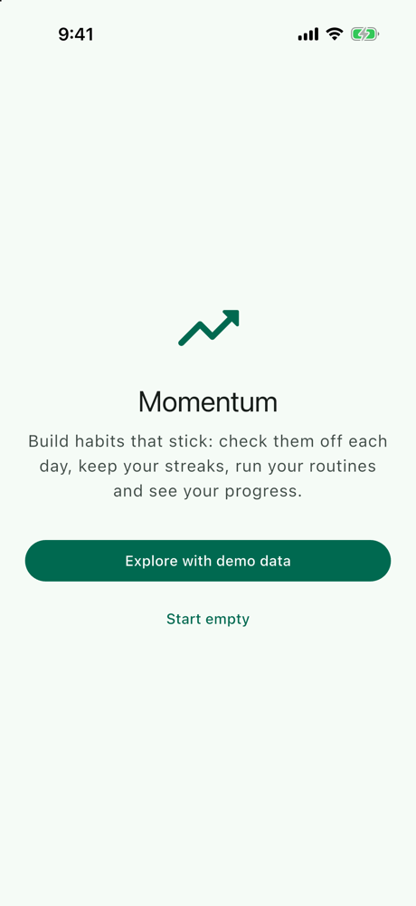 | 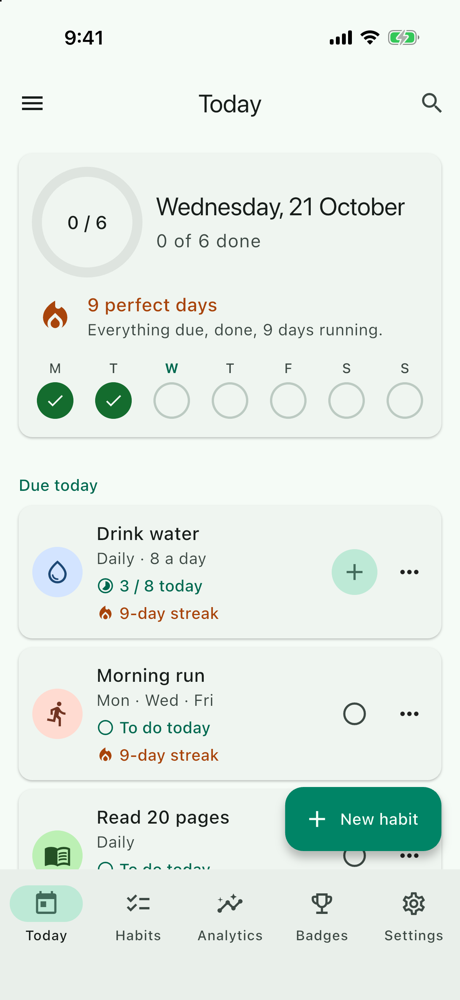 | 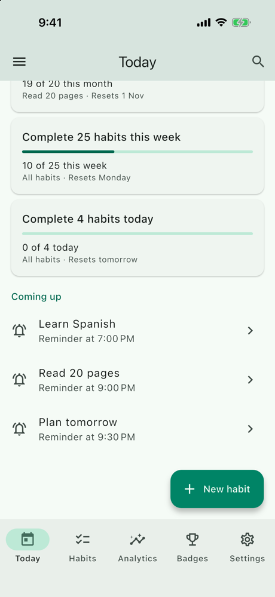 |

| Badges celebrated | Habits | A habit's page |
|:---:|:---:|:---:|
| 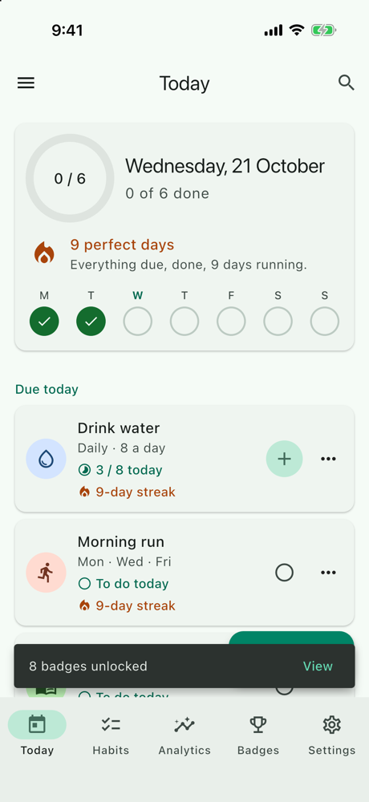 | 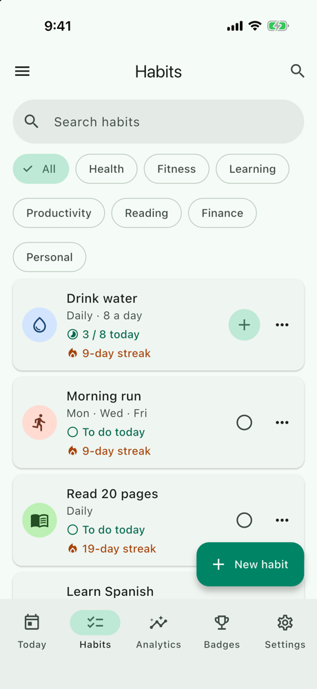 | 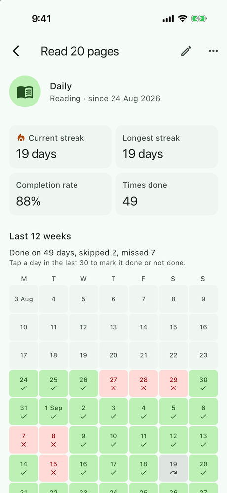 |

| The drawer | Routines |
|:---:|:---:|
| 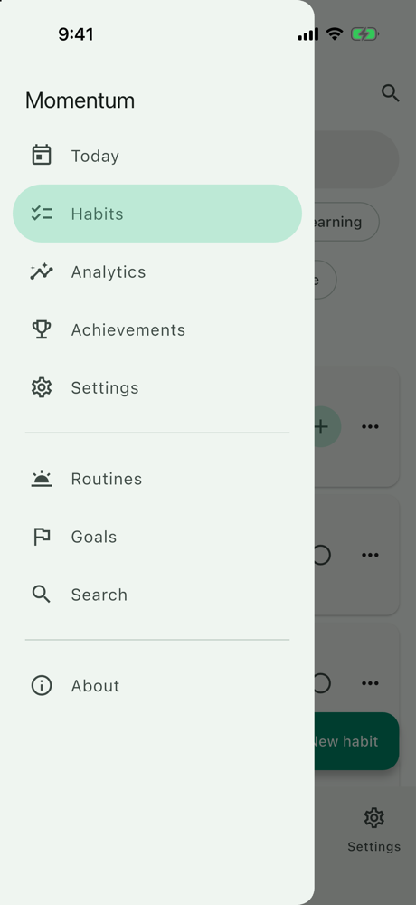 | 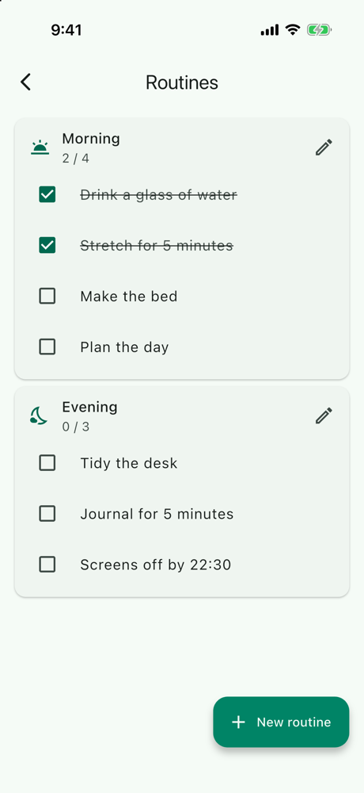 |

## Dark

| Analytics | Achievements | A goal |
|:---:|:---:|:---:|
| 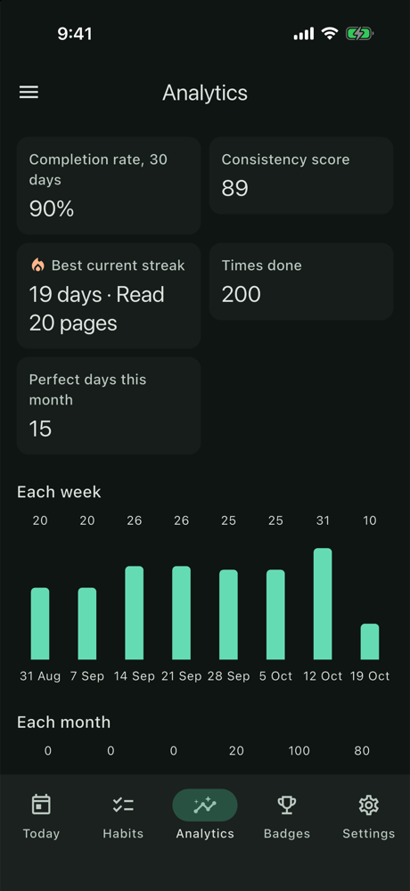 | 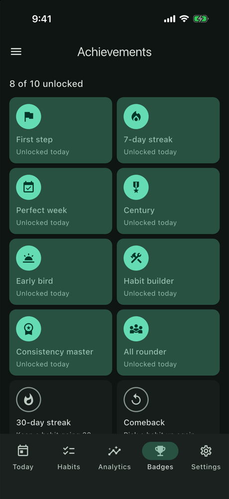 | 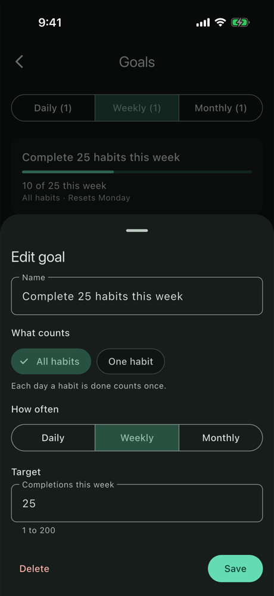 |

| Search | Settings | Backup and developer tools |
|:---:|:---:|:---:|
| 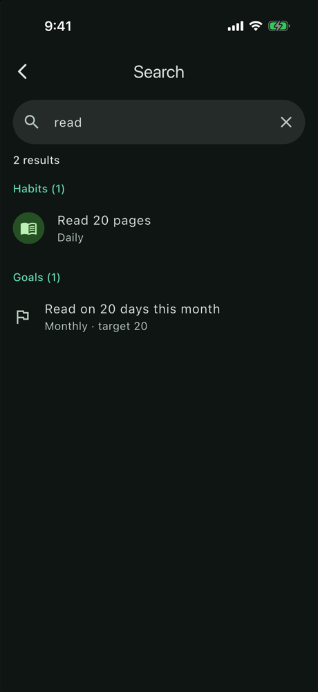 | 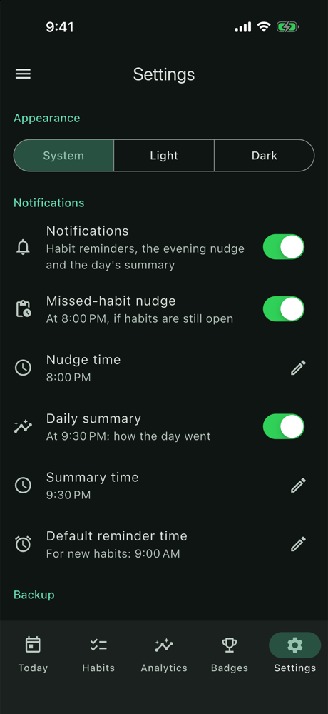 | 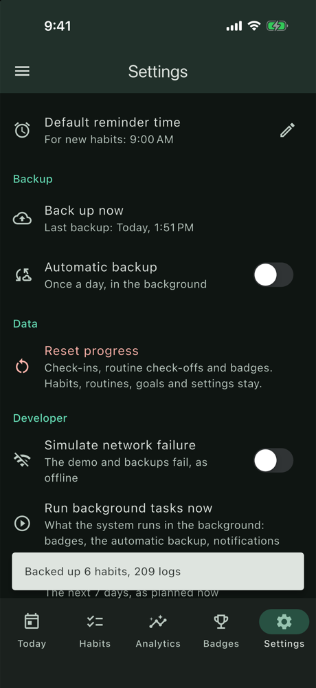 |

| Planned notifications |
|:---:|
| 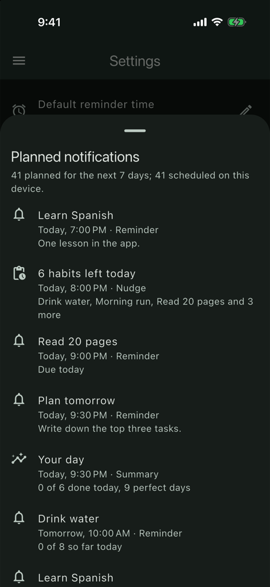 |

## Large text

Accessibility text size **AX3** (about 235 %), dark mode.

| Today | Habits | Settings |
|:---:|:---:|:---:|
| 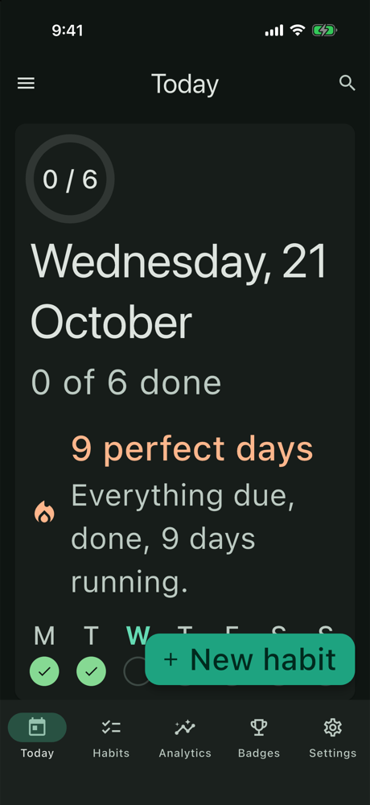 | 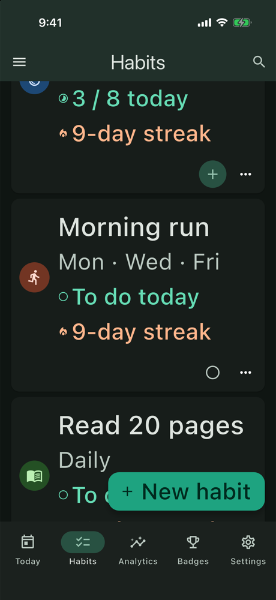 | 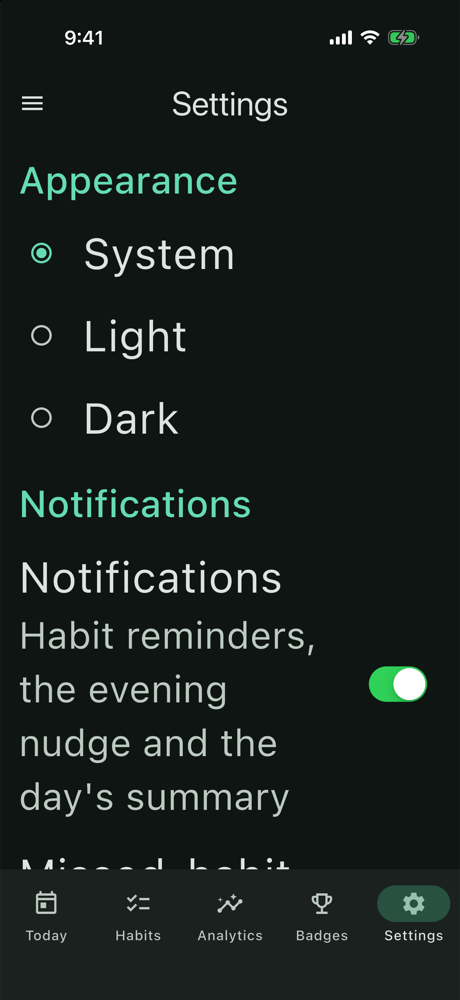 |

## Android, dynamic color

Android 16 emulator, light mode, Dynamic color on: the app takes its colors from the wallpaper (a muted blue) instead of its own green.

| Today | Settings |
|:---:|:---:|
| 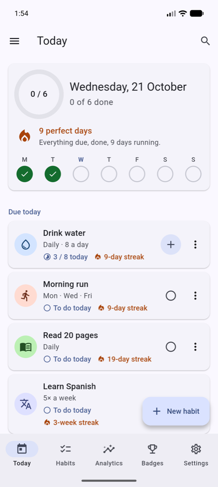 | 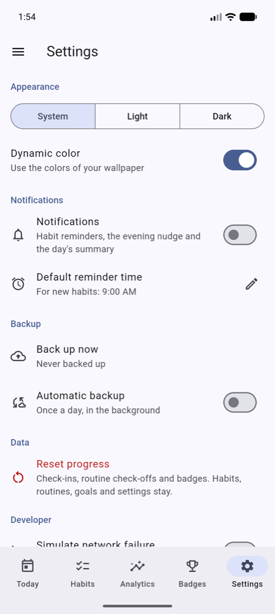 |

## What to look for

- **One history, many figures:** Today's ring and perfect days, the habit page's calendar, the goals, Analytics and the badges all come from the same logs, derived when each screen reads them.
- **Schedules respected:** Morning run's 9-day streak counts its Mondays, Wednesdays and Fridays only; Learn Spanish's streak is in weeks.
- **Never color alone:** done, missed and skipped days each have an icon; routine steps are struck through and checked.
- **The plan follows the data:** the planned notifications list only habits still open today, and the nudge counts them.
- **Platform touches:** iOS switches and the time wheel on iOS; Material switches and wallpaper colors on Android.
- **Large text:** text wraps rather than truncating, cards stack their buttons, segments become radio buttons, and the tab labels keep their size (a long press shows them).

## Retaking them

```bash
fvm flutter build ios --simulator --debug
xcrun simctl uninstall booted co.bitfuse.flutter.momentum          # a fresh install
xcrun simctl install booted build/ios/iphonesimulator/Runner.app
xcrun simctl launch booted co.bitfuse.flutter.momentum             # then Explore with demo data

xcrun simctl status_bar booted override --time 9:41 --dataNetwork wifi --wifiBars 3 --cellularBars 4 --batteryState charged --batteryLevel 100
xcrun simctl ui booted appearance dark                             # or light
xcrun simctl ui booted content_size accessibility-extra-large      # AX3; "large" is the default

xcrun simctl io booted screenshot docs/screenshots/<name>.png
sips -Z 1000 docs/screenshots/<name>.png                           # downscale (macOS)

xcrun simctl status_bar booted clear                               # afterwards
```

On Android: `adb exec-out screencap -p > docs/screenshots/<name>.png`, then the same `sips` step.

The demo's dates follow the device's date, so the figures change with the day of the week; on a Wednesday afternoon they match HABIT_ENGINE.md.
